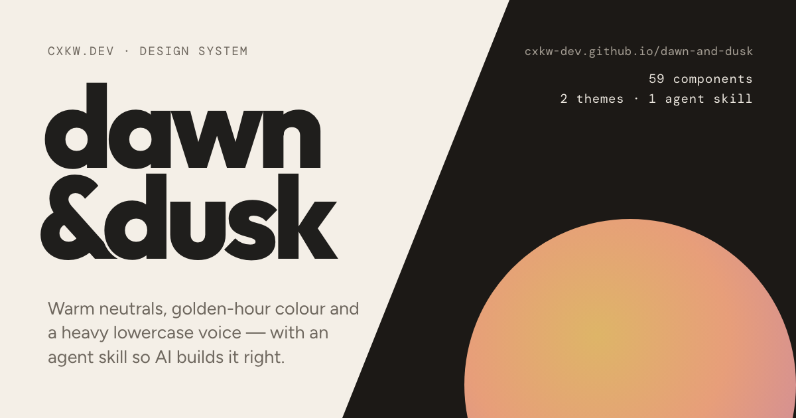

<p align="center">
  <a href="https://cxkw-dev.github.io/dawn-and-dusk/"></a>
</p>

# dawn & dusk

A warm, quiet design system in two moods. **59 HTML/CSS components**, dawn and dusk themes, and a small typed React layer.

[Getting started](https://cxkw-dev.github.io/dawn-and-dusk/getting-started/) · [Components](https://cxkw-dev.github.io/dawn-and-dusk/components/button/) · [Download an HTML starter](https://github.com/cxkw-dev/dawn-and-dusk/releases/download/v0.2.0/dawn-and-dusk-html-0.2.0.zip)

## Install in your app

One command. No npm account or repository clone needed:

```sh
npm install https://github.com/cxkw-dev/dawn-and-dusk/releases/download/v0.2.0/dawn-and-dusk-0.2.0.tgz
```

This is a versioned npm package hosted on GitHub Releases. npm installs it as `dawn-and-dusk` and records its integrity
in your lockfile. It is not yet published in the npm registry.

### React

```jsx
import 'dawn-and-dusk/styles.css';
import { Button, Card, Input, Icon, ThemeToggle } from 'dawn-and-dusk/react';

export default function App() {
  return (
    <Card>
      <Input label="Project name" placeholder="My project" />
      <Button variant="primary"><Icon name="plus" />Create project</Button>
      <ThemeToggle />
    </Card>
  );
}
```

Native props, events and refs work as expected. The React entry includes **Button, Input, Card, Badge, Icon,
ThemeToggle and setTheme**. Icons render inline. Complex widgets such as selects, date pickers and data tables currently
use the HTML/CSS APIs; they are not React exports. React 18 and 19 are supported.

**Next.js:** import the CSS in `app/layout.jsx`. Add `ThemeScript` from `dawn-and-dusk/theme` to `<head>` and
`suppressHydrationWarning` to `<html>` to restore a saved theme before hydration.
[Complete Next.js setup](https://cxkw-dev.github.io/dawn-and-dusk/getting-started/#next).

### HTML or another client-side app

```js
import 'dawn-and-dusk/styles.css';
import 'dawn-and-dusk/auto'; // optional interactions; includes icons
```

```html
<button class="dd-btn dd-btn--primary">Create project</button>
<button class="dd-btn dd-btn--ghost" data-dd-theme-toggle>Switch theme</button>
```

The CSS works on its own. Use `auto` for HTML-owned interactions; keep it out of stateful React markup.

## Start from a working page

| Starter | Start it |
|---|---|
| [HTML](https://github.com/cxkw-dev/dawn-and-dusk/releases/download/v0.2.0/dawn-and-dusk-html-0.2.0.zip) | Unzip and open `index.html`. No build tools. |
| [React](https://github.com/cxkw-dev/dawn-and-dusk/releases/download/v0.2.0/dawn-and-dusk-react-0.2.0.zip) | Unzip, run `npm install`, then `npm run dev`. |
| [Next.js](https://github.com/cxkw-dev/dawn-and-dusk/releases/download/v0.2.0/dawn-and-dusk-next-0.2.0.zip) | Unzip, run `npm install`, then `npm run dev`. |

The app starters require Node.js 22.12+ or 24+. Each includes a working form, icons and a theme switch.

## A few useful defaults

- **Theme:** follows your system. Set `data-theme="dawn"` or `"dusk"` on `<html>` to choose explicitly.
- **Fonts:** Outfit, Figtree and DM Mono load from Google Fonts. Import `styles-no-fonts.css` if you self-host fonts.
- **Tokens only:** import `dawn-and-dusk/tokens.css`.
- **Global styles:** the full stylesheet includes a page reset and a 17px root font size.
- **Agent skill:** optional, installed per project. [Set up an agent](https://cxkw-dev.github.io/dawn-and-dusk/skill/).

## Contributing and license

[Contributor guide](CONTRIBUTING.md) · [MIT license](LICENSE) · [Third-party notices](THIRD_PARTY_NOTICES.md)

Solar icons are by 480 Design under CC BY 4.0. Project-specific AI icons are additions. Fonts retain their SIL Open Font licenses.
